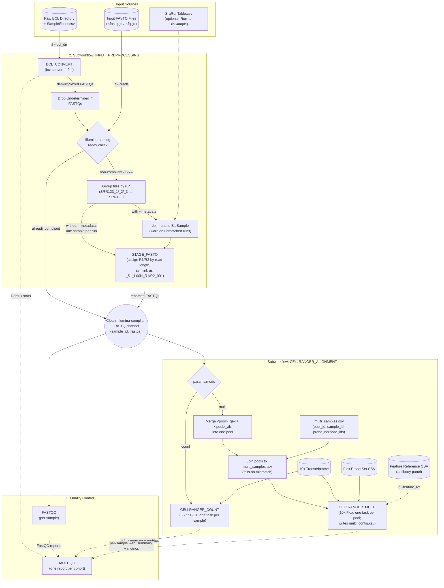

# scRNA-seq Pre-processing Pipeline (Nextflow)

This pipeline takes 10x Genomics single-cell RNA-seq data from raw sequencer output (BCL) or from FASTQ files (including SRA downloads) through to Cell Ranger count matrices. It also produces a single MultiQC report per cohort.

It supports two Cell Ranger modes:

| Mode | Cell Ranger command | Use for |
| --- | --- | --- |
| `count` (default) | `cellranger count` | Standard 3′ / 5′ gene-expression libraries, one sample per library (e.g. the UCSD SRA cohort) |
| `multi` | `cellranger multi` | 10x Flex (probe-based) multiplexed libraries, optionally with antibody capture (TotalSeq-C) |

## Pipeline overview



## How inputs are handled

### 1. Where the FASTQs come from

- **BCL input** (`--bcl_dir` + `--bcl_samplesheet`): `BCL_CONVERT` demultiplexes the run. `Undetermined_*` FASTQs are published for inspection but are **not** passed downstream.
- **FASTQ input** (`--reads`): every file matching the glob is used. Always quote the pattern so the shell doesn't expand it.

### 2. Illumina naming check

Cell Ranger needs file names of the form `<Sample>_S<n>_L<nnn>_<R1|R2|I1|I2>_001.fastq.gz`.

- **Compliant files** go straight through. Everything before `_S<n>_` becomes the sample ID.
- **Non-compliant files**, such as SRA downloads named `SRR12623961_1.fastq.gz`, are grouped by run (`SRR12623961`). They are then optionally grouped by BioSample and renamed by `STAGE_FASTQ`.

### 3. Grouping SRA runs into samples (`--metadata`)

If you supply an SRA Run Selector table, runs are joined to it on the `Run` column and grouped by `BioSample`. All runs of one BioSample then become one Cell Ranger sample, with each run given its own lane number (`L001`, `L002`, …). To group by a different column (e.g. `Experiment`), edit the `.map { row -> tuple(row.Run, row.BioSample) }` line in [`subworkflows/input_preprocessing.nf`](subworkflows/input_preprocessing.nf).

Runs that appear in only one place are skipped with a `WARNING` in the log:

- runs listed in the table but with no FASTQs on disk
- FASTQs on disk that aren't in the table

Check the log for these warnings: a BioSample missing some of its runs will still be processed, just with fewer reads.

Without `--metadata`, each run is treated as its own sample.

### 4. Assigning R1 / R2 (`STAGE_FASTQ`)

SRA file suffixes (`_1`, `_2`, `_3`) don't reliably say which read is which, so `STAGE_FASTQ` decides from the **length of the first read** in each file:

| Files per run | Assignment |
| --- | --- |
| 2 | shorter → R1 (cell barcode + UMI, ~26–28 bp), longer → R2 (cDNA) |
| 3 | shortest = index read (skipped), middle → R1, longest → R2 |
| other | task fails with a clear error |

If two files have the same length (e.g. 5′ paired-end 2×150), the `_1`/`_2` order is kept. Each task's `.command.log` records the decision and the read lengths, so check one after the first real run.

> **Downloading from SRA:** use [`../bash/sra_download.sh`](../bash/sra_download.sh). It runs `fasterq-dump --include-technical`, because for many 10x submissions the barcode read is flagged as "technical" and would otherwise be dropped.

## Cell Ranger modes

### `count` mode

Each sample in the clean FASTQ channel becomes one `cellranger count` task. It needs only `--transcriptome`.

### `multi` mode (10x Flex)

Each **pool** (one GEM lane) becomes one `cellranger multi` task. The pipeline writes `multi_config.csv` itself, so you never edit 10x's config by hand.

**FASTQ naming.** Each pool's FASTQ prefixes must end in `_gex` (Gene Expression) or `_ab` (Antibody Capture). Everything before that is the pool ID. For example, `16k_Human_PBMCs_TotalseqC_4plex_gex_S1_L001_R1_001.fastq.gz` and `16k_Human_PBMCs_TotalseqC_4plex_ab_S1_L001_R1_001.fastq.gz` both belong to pool `16k_Human_PBMCs_TotalseqC_4plex`. Each becomes its own row in the `[libraries]` section.

**`multi_samples.csv`** maps the samples in each pool to their barcodes. The pool IDs must match the FASTQ pool IDs exactly, and any mismatch stops the run:

```csv
pool_id,sample_id,probe_barcode_ids
16k_Human_PBMCs_TotalseqC_4plex,PBMC_TotalSeqC_C-A01,C-A01
16k_Human_PBMCs_TotalseqC_4plex,PBMC_TotalSeqC_C-B01,C-B01
```

Copy the barcode IDs from the `[samples]` section of the 10x config that came with the data. In Flex v2 a single ID (e.g. `C-A01`) covers both GEX and antibody reads.

**Reference files:**

- `--probe_set` (required): must be the probe set the data was generated with.
- `--feature_ref`: required whenever there is an `_ab` library. Use the feature reference supplied by 10x; Flex uses a different read pattern from standard TotalSeq-C 3′/5′ assays, so don't build your own. If you open it in Excel, re-check it before use, because Excel can corrupt the IDs.

## Parameters

| Parameter | Default | Description |
| --- | --- | --- |
| `--mode` | `count` | `count` or `multi` |
| `--cohort` | `training_ucsd` | Name used for the output sub-folder (`<outdir>/<cohort>/`) |
| `--outdir` | `<launchDir>/results` | Top-level output folder |
| `--bcl_dir` | `null` | BCL run folder. If set, the pipeline starts from BCL |
| `--bcl_samplesheet` | `null` | Illumina sample sheet (required with `--bcl_dir`) |
| `--reads` | `data/<cohort>/fastq/*.{fastq,fq}.gz` | FASTQ glob (quote it!) |
| `--metadata` | `null` | SRA run table used to group runs by `BioSample` |
| `--multi_samples` | `data/<cohort>/multi_samples.csv` | Pool → sample → barcode sheet (multi mode) |
| `--transcriptome` | `data/reference/refdata-gex-GRCh38-2024-A` | 10x reference folder (both modes) |
| `--probe_set` | `data/reference/Chromium_Human_Transcriptome_Probe_Set_v2.0_GRCh38-2024-A.csv` | Flex probe set (multi mode) |
| `--feature_ref` | `null` | Antibody feature reference (multi mode with `_ab` libraries) |
| `--create_bam` | `false` | Ask Cell Ranger to write BAM files |
| `--skip_fastqc` | `false` | Skip FastQC |
| `--skip_multiqc` | `false` | Skip MultiQC |
| `--email` | `false` | Address to email when the run finishes (the cluster must have `mail` set up) |

Defaults that contain `<cohort>` are filled in from `--cohort`. When in doubt, pass the paths explicitly and check the header the pipeline prints at start-up.

## Running the pipeline

Run from the project root. On the HPC, launch inside `tmux`/`screen` or as a small SLURM job, because the `nextflow` process must stay alive for the whole run.

### Count mode (SRA / standard 3′ data)

```bash
BASE=/scratch/<user>/ucsd_cohort

nextflow run src/masters_project/nextflow/main.nf -profile hpc \
  --mode count \
  --cohort ucsd_cohort \
  --reads "$BASE/fastq/*.fastq.gz" \
  --metadata data/ucsd_cohort/metadata/SraRunTable.csv \
  --transcriptome data/ucsd_cohort/references/refdata-gex-GRCh38-2024-A \
  --outdir $BASE/results \
  -work-dir $BASE/work \
  -resume
```

### Multi mode (10x Flex)

```bash
BASE=/scratch/<user>/flexv2_pbmc

nextflow run src/masters_project/nextflow/main.nf -profile hpc \
  --mode multi \
  --cohort flexv2_pbmc \
  --reads "$BASE/fastq/16k_Human_PBMCs_TotalseqC_4plex_fastqs/*/*.fastq.gz" \
  --multi_samples $BASE/metadata/multi_samples.csv \
  --feature_ref $BASE/metadata/feature_reference.csv \
  --probe_set /path/to/Chromium_Human_Transcriptome_Probe_Set_v2.0.0_GRCh38-2024-A.csv \
  --transcriptome /path/to/refdata-gex-GRCh38-2024-A \
  --outdir $BASE/results \
  -work-dir $BASE/work \
  -resume
```

### Dry run (stub mode)

Before a real run, add `-stub` and use `-profile laptop`. Every process then creates empty placeholder outputs in seconds. This checks that the inputs are found and the channels are wired correctly (e.g. that `_gex` and `_ab` merge into one pool). It does **not** check read lengths or run any tool.

## Outputs

All outputs are written under `<outdir>/<cohort>/`:

```text
fastq_demux/          # FASTQs from bcl-convert (BCL input only)
bcl_reports/Reports/  # bcl-convert demultiplexing stats (BCL input only)
qc/fastqc/            # FastQC HTML + zip per sample
qc/multiqc/           # multiqc_report.html + multiqc_data/
cellranger/           # count mode: one folder per sample (web_summary, matrices, ...)
cellranger_multi/     # multi mode: per-pool outs/, including per_sample_outs/<sample>/
pipeline_info/        # Nextflow timeline, report, trace and DAG
```

The filtered count matrices for downstream analysis are at:

- **count mode:** `cellranger/<sample>/outs/filtered_feature_bc_matrix/`
- **multi mode:** `cellranger_multi/<pool>/outs/per_sample_outs/<sample>/sample_filtered_feature_bc_matrix/`

## Profiles, resources and error handling

| Profile | Executor | Software |
| --- | --- | --- |
| `laptop` | local (6 CPUs, 12 GB) | Singularity containers for FastQC/MultiQC; intended for `-stub` runs |
| `hpc` | SLURM (`standard` queue; `highmem` for Cell Ranger and bcl-convert) | Environment modules: `bcl-convert/4.2.4`, `cellranger/10.0.0`, `fastqc/0.13.0`, `multiqc/1.35-py313` |

Module names are specific to each cluster. Check them with `module avail` and edit the `hpc` profile in [`nextflow.config`](nextflow.config) if yours differ.

- **Out-of-memory / time-out errors** (exit codes 137–140, 143) are retried up to 2 times with more memory and time each attempt. The limit is set by `resourceLimits`, which you should set to your cluster's maximum.
- **Cell Ranger failures** (count and multi) are **ignored** rather than stopping the run, so the remaining samples and MultiQC still complete. Failed samples are listed in the end-of-run summary and in `pipeline_info/execution_trace.txt` (status `FAILED`). Fix the problem and re-run with `-resume`.
- Any other failure stops the pipeline after the tasks already running have finished.
- Cell Ranger is given 4 GB less memory than the SLURM job, so SLURM doesn't kill it for slightly exceeding its allocation.

## Project layout

```text
main.nf                            # entry point: header, QC, reference channels, MultiQC
nextflow.config                    # parameters, resource labels, profiles, reports
subworkflows/input_preprocessing.nf
subworkflows/cellranger_alignment.nf
modules/bcl_convert.nf             # BCL_CONVERT
modules/cellranger.nf              # STAGE_FASTQ, CELLRANGER_COUNT, CELLRANGER_MULTI
modules/qc.nf                      # FASTQC, MULTIQC
```
